<div align="center">



# AI Command

**A command, placed on the line. You press Enter.**<br>
One request in plain language. One reading when the words are sure. Two or three when they fork. Nothing runs until you say so.

<a href="#jack-in"></a>
<a href="#keys"></a>

<a href="https://omarchy.org"></a>

<kbd>[jack in](#jack-in)</kbd>&nbsp;
<kbd>[the line](#the-line)</kbd>&nbsp;
<kbd>[keys](#keys)</kbd>&nbsp;
<kbd>[faq](#faq)</kbd>

</div>

`cmd` reads one sentence, asks Grok for the shell command you meant, and puts that command on the line. It does not run it.


## Jack in

```sh
curl -fsSL https://raw.githubusercontent.com/uxeric/ai-command/HEAD/install.sh | bash
```


## The line

```sh
cmd git command to merge dev into test
```

The words can mean two things. The card shows both, title on the left and what it does on the right:

```text
▶ merge into test          brings dev's commits into test and keeps dev
  merge and delete dev     merges into test, then deletes the dev branch

  git checkout test && git merge dev
  clarify
```

The ice line is the command that will land on the prompt. The bottom row is yours. Type what the words left out, and the readings are asked again.

A sure request shows one reading. The pointer is leaf. A fork shows two or three, and the pointer is hot. There is never a fourth.

↑ and ↓ move. Enter places the focused line. z jumps to clarify. Esc places nothing.


## Keys

1. Install the Grok CLI if `grok` is not already on your PATH:

```sh
curl -fsSL https://x.ai/cli/install.sh | bash
```

2. Sign in. A browser opens, and Grok writes the session to `~/.grok/auth.json` on your machine:

```sh
grok login
```

No browser on that machine:

```sh
grok login --device-auth
```

3. Leave that file alone. `ls -l ~/.grok/auth.json` should show `-rw-------`. Do not commit it, do not paste it into this repo, and do not copy it into a script. If the login is missing or stale, `cmd` stops and tells you to run `grok login` again. It refreshes the session when it is near expiry.

An `XAI_API_KEY` in the environment is not read. The login file is the only credential.

| If you want to point it somewhere | |
|---|---|
| `CMD_MODEL` | Model id. Otherwise `[models] default` in `~/.grok/config.toml`, otherwise `grok-4.7`. |
| `CMD_EFFORT` | Reasoning effort. Default `low`. |
| `CMD_NO_UPDATE_CHECK` | Set to skip the update check. |
| `CMD_NO_FX` | Set to skip the card's animation. |
| `GROK_HOME` | Directory that holds `auth.json`, if it is not `~/.grok`. |


## FAQ

> [!NOTE]
> **Does it run the command?**<br>
> No. The line sits on the prompt. Enter there is what runs it. Esc at the card places nothing. Read the ice line before you place it, and read the prompt before you press Enter.

> [!IMPORTANT]
> **Where do I put the key?**<br>
> You don't put it in the project. Run `grok login`. The session stays in `~/.grok/auth.json`, which is not part of this repo.

> [!NOTE]
> **Why two lines for a merge?**<br>
> "Merge dev into test" can keep dev or delete it. When the words don't say, both are offered. The bottom row is where you say which.

<div align="center">
<br>


<sub><code>// not executed</code></sub>

</div>
